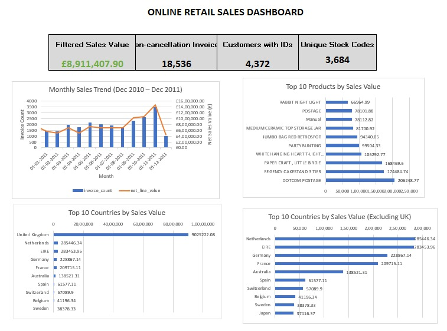

# Online Retail Sales Analysis

## Project Overview
This project analyzes an online retail transaction dataset using MySQL and Microsoft Excel. The goal is to identify sales trends, top-performing products, important markets, and customer purchasing patterns.

## Tools Used
- MySQL and MySQL Workbench
- Microsoft Excel
- SQL for data cleaning, aggregation, and analysis

## Dataset
This project uses the Online Retail dataset, sourced from the UCI Machine Learning Repository 
**LINK**: https://archive.ics.uci.edu/dataset/352/online+retail.

The dataset contains online retail transactions from December 2010 to December 2011, including invoice numbers, product codes, descriptions, quantities, invoice dates, unit prices, customer IDs, and countries. It was used to analyze sales trends, product performance, customer purchasing patterns, and international markets.

## Work Completed
- Imported and validated the retail dataset in MySQL.
- Performed data-quality checks for cancellations, negative quantities, zero-price transactions, and missing customer IDs.
- Created an analysis view with calculated line values and transaction classifications.
- Analyzed monthly sales trends.
- Identified top products, leading countries, and high-value customers.
- Built an Excel dashboard with KPI cards and four charts.
- Documented key findings and business implications.

## Key Findings
- November 2011 had the highest monthly filtered sales value in the analyzed monthly results.
- The Netherlands and EIRE ranked highest among international markets by filtered sales value.
- Some high-ranking product entries represent postage or manual-entry codes rather than ordinary merchandise.
- Some customers have unusually high transaction values relative to their invoice counts.
- Transaction anomalies make clear KPI definitions and data-quality checks important.

## Dashboard Preview

The interactive charts and underlying analysis are available in
[Online_Retail_Dashboard.xlsx](Online_Retail_Dashboard.xlsx).

## Business Recommendations
- Investigate seasonal demand before peak trading periods.
- Review international market opportunities alongside shipping costs and customer retention.
- Separate merchandise from postage and manual-entry codes when evaluating product performance.
- Validate unusual customer transactions before making customer-value decisions.
- Document sales and cancellation rules consistently in reporting.

## Project Files
- `Online_Retail_Dashboard.xlsx` — Excel dashboard and analysis insights.
- SQL scripts — data preparation, validation, and analysis queries.
- CSV exports — results used to build the Excel charts.

## Notes
The December 2011 data ends on December 9, so December is a partial month. Filtered sales-value metrics are analytical measures and should not automatically be interpreted as final recognized revenue.
